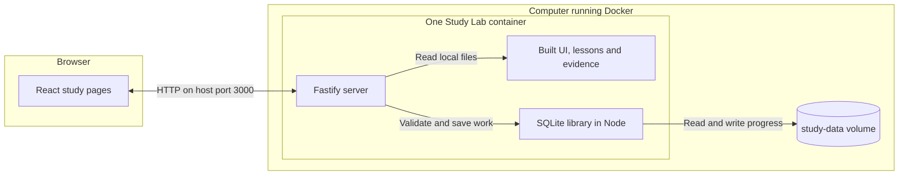

# **Architecture**

Study Lab has one server on your computer and one shared learner profile — a browser displays the lessons, while the server saves progress in SQLite

[Back to the README](../README.md#how-it-works)

## **The Main Parts**

The React code runs in the browser — the built JavaScript and CSS files are stored in the image and served by Fastify, with no separate frontend server in normal study use

The SQLite library runs in the same Node process as Fastify — the named volume holds its database file and is not a separate database service

The default address is [http://localhost:3000](http://localhost:3000) — Compose publishes the computer's `127.0.0.1:3000` port to port `3000` inside the container

For a phone, the owner must explicitly enable [trusted LAN access](operations.md#explicit-lan-option) and use the computer's local address — the computer and server must remain running

| Term         | Meaning here                                                                |
| ------------ | --------------------------------------------------------------------------- |
| Frontend     | The study pages and interaction code that run in the browser                |
| Backend      | The one Fastify server that sends files and handles study requests          |
| API          | The server addresses the browser uses to load or save data                  |
| Container    | The packaged server, runtime and built files that Docker starts             |
| Named volume | A data location managed by Docker that remains when a container is replaced |

## **Lessons and Evidence**

[content/lessons.json](../content/lessons.json) contains the two lessons, stable IDs, content versions, objectives, tasks, answer keys, hints, feedback, writing rubrics and source metadata

The build includes this lesson data in the server output — the server parses it with the shared validation schema when it starts

[public/evidence/](../public/evidence/) contains the original synthetic PCAP, decoded summary and attribution — Vite copies these local files into `dist/client/evidence` during the build

The server supplies lesson JSON through the API and evidence files through local download addresses — no lesson download, AI service, font CDN or cloud database is required during study

The browser evidence table supports review on a phone — it does not replace full investigation in desktop Wireshark

See [content and sources](content-and-sources.md) for provenance and evidence checks

## **Requests and Saving**

The browser uses hash routes such as `#/review` to select a page — Fastify serves the built app and handles these API addresses

| Request                  | Purpose                                               |
| ------------------------ | ----------------------------------------------------- |
| `GET /api/health`        | Check that the server can query SQLite                |
| `GET /api/lessons`       | Load lessons and the shared learner's progress        |
| `POST /api/progress/:id` | Save one validated action for the lesson with that ID |

A learner's typing stays in the current page until a save succeeds — the card requests an autosave after 350 ms without another edit, and ordinary in-app navigation saves the latest draft before leaving

The saving hook sends one request at a time — each request uses the revision number confirmed by the previous response, and the UI reports **Saved** only after that response succeeds

A revision is a number that changes after each successful write — if another window or phone has already saved a newer revision, the server returns a conflict instead of overwriting it

After a save error, queued actions stop and the visible draft remains — the learner can copy it before retrying or reloading, using [the study help](../README.md#using-study-lab)

The server validates request sizes and fields, checks the lesson and task, then applies the domain rules inside a SQLite write transaction — a transaction saves the change together or rolls it back if it fails

## **Where Progress Lives**

| Item                             | Location                                                               |
| -------------------------------- | ---------------------------------------------------------------------- |
| Database inside Docker           | `/app/data/study.sqlite`                                               |
| Persistent mount                 | Compose volume `study-data` mounted at `/app/data`                     |
| Usual Docker volume name         | Project name followed by `_study-data`, such as `study-lab_study-data` |
| Database during host development | `data/study.sqlite`, unless `DATABASE_PATH` selects another location   |

SQLite schema version 1 uses a `progress` table keyed by lesson ID — each record stores its content version, revision, answer text, checked attempts and their results/timestamps, mistake counts, current activity, hints, solution use, self-review and completion time

Older records may have no attempt history — the app keeps a fallback message for those records instead of inventing an incorrect answer

Normal stop/start and container recreation keep the named volume — changing the Compose project name or copying only the source files can select a different database

Do not treat a Git copy as a progress backup — use [the tested SQLite backup and restore commands](operations.md#backup-and-restoration), and read [verification](verification.md) for their recorded results and limits

There is no sign-in — everyone allowed to access this installation reads and changes the same learner profile, and there are no separate private browser or phone accounts

## **Assessment Rules**

- Precise tasks use declared answers and task-specific case or whitespace handling — there is no fuzzy spelling match
- The HTTP URI activity preserves case
- Writing requires an explicit learner self-review against a rubric and language checklist — text length alone is not a technical grade
- Completion requires every precise answer and the written self-review, followed by an explicit completion action
- Editing an assessed answer reopens the lesson
- Hints and revealed solutions are recorded separately from correctness — assisted completion does not prove independent mastery
- All lessons and activities are unlocked, with order recommended rather than enforced

These rules live in [src/shared/domain.ts](../src/shared/domain.ts), separate from HTTP handlers and React rendering

## **Local Runtime**

| Part           | Current choice                                          |
| -------------- | ------------------------------------------------------- |
| Browser UI     | React 19, TypeScript 6 and local CSS, built with Vite 8 |
| Server         | Fastify 5 on Node 24                                    |
| Validation     | Zod 4                                                   |
| Storage        | Node's built-in SQLite library                          |
| Docker build   | `node:24.22.2-bookworm-slim` with pnpm `10.32.1`        |
| Docker runtime | `node:24.22.2-alpine`, running as non-root user `node`  |

Exact package versions are in [package.json](../package.json) and [pnpm-lock.yaml](../pnpm-lock.yaml) — [.node-version](../.node-version) pins Node `24.22.2` for development

The [Dockerfile](../Dockerfile) builds the client and server, removes development dependencies and copies built files into the runtime image — the final image removes package-manager tools and contains no learner database

[compose.yaml](../compose.yaml) gives the app a read-only image, the writable data volume, a small temporary filesystem and reduced container privileges — its health check queries the local API and SQLite

Both pinned base images list `linux/amd64` and `linux/arm64` — there is no forced `platform` setting, but Mac and native Linux installations remain untested and other processor types are not covered by the setup guide

Request-origin and host checks reduce unwanted browser access, but do not provide authentication — see [security boundaries](security.md)

## **Code Map**

| File or folder                                              | Purpose                                                                       |
| ----------------------------------------------------------- | ----------------------------------------------------------------------------- |
| [src/client/App.tsx](../src/client/App.tsx)                 | Dashboard, lesson page, mistake review and evidence table                     |
| [src/client/TaskCard.tsx](../src/client/TaskCard.tsx)       | Answers, hints, solutions and explicit writing self-review                    |
| [src/client/use-progress.ts](../src/client/use-progress.ts) | Ordered saves, confirmed status and retry state                               |
| [src/client/api.ts](../src/client/api.ts)                   | Browser requests to the backend                                               |
| [src/client/style.css](../src/client/style.css)             | Local styles and responsive layout                                            |
| [src/server/main.ts](../src/server/main.ts)                 | Server start and normal shutdown                                              |
| [src/server/app.ts](../src/server/app.ts)                   | API routes, security headers and static files                                 |
| [src/server/store.ts](../src/server/store.ts)               | SQLite schema, reads and transactional writes                                 |
| [src/shared/schema.ts](../src/shared/schema.ts)             | Lesson, progress and request contracts                                        |
| [src/shared/domain.ts](../src/shared/domain.ts)             | Marking, completion and revision rules                                        |
| [src/shared/lessons.ts](../src/shared/lessons.ts)           | Parse bundled lessons on startup                                              |
| [scripts/](../scripts/)                                     | Content/evidence validation, backup, restore, hooks and smoke/security checks |
| [tests/](../tests/)                                         | Domain, HTTP, UI and complete browser scenarios                               |
| [.github/workflows/ci.yml](../.github/workflows/ci.yml)     | Quality, test, Docker and security jobs                                       |

## **Future Changes**

Task IDs stay stable — changed task meaning or answer keys need a deliberate content-version decision before release

At present, a content-version mismatch preserves old work and rejects edits with a conflict — future lesson packs need an explicit migration policy rather than silently reusing correctness from changed questions

SQLite schema changes also need a migration and backup/restore checks — only schema version 1 is implemented now

AI, placement assessments, spaced repetition and more lessons are planned, with no provider or AI credentials required by the current app — see the [roadmap](roadmap.md)
