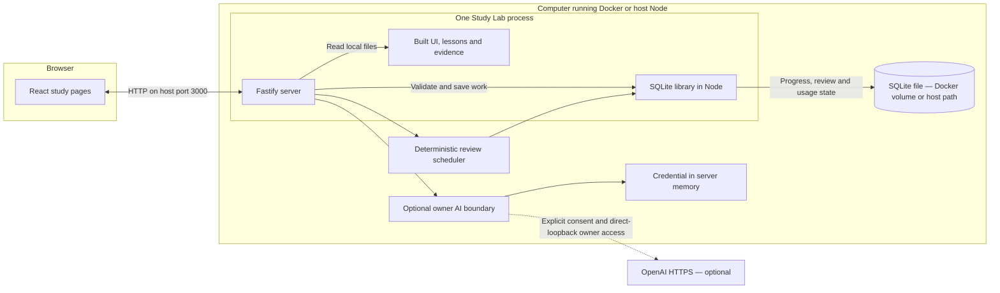
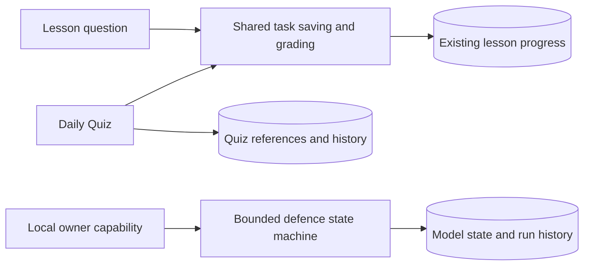
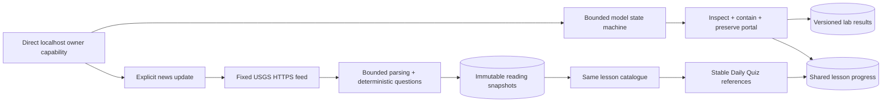

# **Architecture**

Study Lab has one server on your computer and one shared learner profile — a browser displays the lessons, while the server saves progress in SQLite

[Back to the README](../README.md#how-it-works)

## **The Main Parts**

The React code runs in the browser — the built JavaScript and CSS files are stored in the image and served by Fastify, with no separate frontend server in normal study use

The SQLite library runs in the same Node process as Fastify — the named volume holds its database file and is not a separate database service

The default address is [http://localhost:3000](http://localhost:3000) — Compose publishes the computer's `127.0.0.1:3000` port to port `3000` inside the container

For a phone, the owner must explicitly enable [trusted LAN access](operations.md#explicit-lan-option) and use the computer's local address — the computer and server must remain running

| Term         | Meaning here                                                                |
| ------------ | --------------------------------------------------------------------------- |
| Frontend     | The study pages and interaction code that run in the browser                |
| Backend      | The one Fastify server that sends files and handles study requests          |
| API          | The server addresses the browser uses to load or save data                  |
| Container    | The packaged server, runtime and built files that Docker starts             |
| Named volume | A data location managed by Docker that remains when a container is replaced |

## **Lessons and Evidence**

[content/lessons.json](../content/lessons.json) contains the 20 lessons, stable IDs, content versions, objectives, tasks, answer keys, hints, feedback, writing rubrics and source metadata

The build includes this lesson data in the server output — the server parses it with the shared validation schema when it starts

[public/evidence/](../public/evidence/) contains the original synthetic PCAP, decoded summary and attribution — Vite copies these local files into `dist/client/evidence` during the build

The server supplies lesson JSON through the API and evidence files through local download addresses — no lesson download, AI service, font CDN or cloud database is required during study

The browser evidence table supports review on a phone — it does not replace full investigation in desktop Wireshark

See [content and sources](content-and-sources.md) for provenance and evidence checks

## **Requests and Saving**

The browser uses hash routes such as `#/review` to select a page — Fastify serves the built app and handles these API addresses

| Request                  | Purpose                                               |
| ------------------------ | ----------------------------------------------------- |
| `GET /api/health`        | Check that the server can query SQLite                |
| `GET /api/lessons`       | Load lessons and the shared learner's progress        |
| `POST /api/progress/:id` | Save one validated action for the lesson with that ID |

A learner's typing stays in the current page until a save succeeds — the card requests an autosave after 350 ms without another edit, and ordinary in-app navigation saves the latest draft before leaving

The saving hook sends one request at a time — each request uses the revision number confirmed by the previous response, and the UI reports **Saved** only after that response succeeds

A revision is a number that changes after each successful write — if another window or phone has already saved a newer revision, the server returns a conflict instead of overwriting it

After a save error, queued actions stop and the visible draft remains — the learner can copy it before retrying or reloading, using [the study help](../README.md#using-study-lab)

The server validates request sizes and fields, checks the lesson and task, then applies the domain rules inside a SQLite write transaction — a transaction saves the change together or rolls it back if it fails

## **Where Progress Lives**

| Item                             | Location                                                               |
| -------------------------------- | ---------------------------------------------------------------------- |
| Database inside Docker           | `/app/data/study.sqlite`                                               |
| Persistent mount                 | Compose volume `study-data` mounted at `/app/data`                     |
| Usual Docker volume name         | Project name followed by `_study-data`, such as `study-lab_study-data` |
| Database during host development | `data/study.sqlite`, unless `DATABASE_PATH` selects another location   |

SQLite schema version 5 retains a `progress` table keyed by lesson ID and a `progress_migrations` archive — progress stores string answers, option-ID arrays or report-field objects with typed selections, content version, revision, checked-attempt history, dismissal watermarks, current activity, assistance, self-review and completion history

Older records may have no attempt history — the app keeps a fallback message for those records instead of inventing an incorrect answer

Normal stop/start and container recreation keep the named volume — changing the Compose project name or copying only the source files can select a different database

Do not treat a Git copy as a progress backup — use [the tested SQLite backup and restore commands](operations.md#backup-and-restoration), and read [verification](verification.md) for their recorded results and limits

There is no sign-in — everyone allowed to access this installation reads and changes the same learner profile, and there are no separate private browser or phone accounts

## **Assessment Rules**

- Precise tasks use declared answers and task-specific case or whitespace handling — there is no fuzzy spelling match
- The HTTP URI activity preserves case
- Radio and drop-down answers use stable option IDs, checkboxes require the exact selected set, and report facts use field-specific answer keys
- Writing requires an explicit learner self-review against a rubric and language checklist — text length alone is not a technical grade
- Completion requires every precise answer, correct report facts and scenario-defined assessment/evidence relationships, plus explicit self-review for writing/report reasoning, followed by an explicit completion action
- Editing an assessed answer reopens the lesson
- Hints and revealed solutions are recorded separately from correctness — assisted completion does not prove independent mastery
- All lessons and activities are unlocked, with order recommended rather than enforced

These rules live in [src/shared/domain.ts](../src/shared/domain.ts), separate from HTTP handlers and React rendering

## **Local Runtime**

| Part           | Current choice                                          |
| -------------- | ------------------------------------------------------- |
| Browser UI     | React 19, TypeScript 6 and local CSS, built with Vite 8 |
| Server         | Fastify 5 on Node 24                                    |
| Validation     | Zod 4                                                   |
| Storage        | Node's built-in SQLite library                          |
| Docker build   | `node:24.22.2-bookworm-slim` with pnpm `10.32.1`        |
| Docker runtime | `node:24.22.2-alpine`, running as non-root user `node`  |

Exact package versions are in [package.json](../package.json) and [pnpm-lock.yaml](../pnpm-lock.yaml) — [.node-version](../.node-version) pins Node `24.22.2` for development

The [Dockerfile](../Dockerfile) builds the client and server, removes development dependencies and copies built files into the runtime image — the final image removes package-manager tools and contains no learner database

[compose.yaml](../compose.yaml) gives the app a read-only image, the writable data volume, a small temporary filesystem and reduced container privileges — its health check queries the local API and SQLite

Both pinned base images list `linux/amd64` and `linux/arm64` — there is no forced `platform` setting, but Mac and native Linux installations remain untested and other processor types are not covered by the setup guide

Request-origin and host checks reduce unwanted browser access, but do not provide authentication — see [security boundaries](security.md)

## **Code Map**

| File or folder                                                    | Purpose                                                                       |
| ----------------------------------------------------------------- | ----------------------------------------------------------------------------- |
| [src/client/App.tsx](../src/client/App.tsx)                       | Dashboard, lesson page, mistake review and evidence table                     |
| [src/client/TaskCard.tsx](../src/client/TaskCard.tsx)             | Answers, hints, solutions and explicit writing self-review                    |
| [src/client/use-progress.ts](../src/client/use-progress.ts)       | Ordered saves, confirmed status and retry state                               |
| [src/client/api.ts](../src/client/api.ts)                         | Browser requests to the backend                                               |
| [src/client/style.css](../src/client/style.css)                   | Local styles and responsive layout                                            |
| [src/server/main.ts](../src/server/main.ts)                       | Server start and normal shutdown                                              |
| [src/server/app.ts](../src/server/app.ts)                         | API routes, security headers and static files                                 |
| [src/server/store.ts](../src/server/store.ts)                     | SQLite schema, reads and transactional writes                                 |
| [src/shared/migrate.ts](../src/shared/migrate.ts)                 | Versioned content migration and preserved previous work                       |
| [src/client/AnswerControls.tsx](../src/client/AnswerControls.tsx) | Native typed controls and safe literal emphasis                               |
| [src/client/Review.tsx](../src/client/Review.tsx)                 | Course filtering, practice, persistent dismissal and Undo                     |
| [src/shared/schema.ts](../src/shared/schema.ts)                   | Lesson, progress and request contracts                                        |
| [src/shared/domain.ts](../src/shared/domain.ts)                   | Marking, completion and revision rules                                        |
| [src/shared/lessons.ts](../src/shared/lessons.ts)                 | Parse bundled lessons on startup                                              |
| [scripts/](../scripts/)                                           | Content/evidence validation, backup, restore, hooks and smoke/security checks |
| [tests/](../tests/)                                               | Domain, HTTP, UI and complete browser scenarios                               |
| [.github/workflows/ci.yml](../.github/workflows/ci.yml)           | Quality, test, Docker and security jobs                                       |

## **Future Changes**

Task IDs stay stable — changed task meaning or answer keys need a deliberate content-version decision before release

Explicit content migrations archive original JSON before updating it, inside one SQLite savepoint — the original Cybersecurity report supports the chain 1 → 2 → 3, followed by additive extensions declared through previousVersion — unsupported migrations preserve the original state and reject access rather than guessing an answer conversion

Additive extensions retain existing question state but reopen completion for newly required questions — changed report structures archive old answers and assistance under Saved Work, with earlier completion retained in `completionHistory`

Unchanged task counters and checks survive — changed activities retain attempts, mistakes and attempt history, archive hints/solution/self-review, and start their new checks unassessed

Review removal records the current mistake count as a watermark — it leaves assessment and completion intact, survives reload and is undone explicitly or superseded by a new incorrect checked attempt

SQLite schema changes also need backup/restore checks — restore accepts schemas 1 through 5, and the app refuses schema versions newer than 5

Review Due, 20 lessons and optional owner AI feedback are implemented — placement assessments and broader learning features remain in the [roadmap](roadmap.md), with no provider or AI credentials required for core study

## Connected Report And Lesson Navigation

Lesson Route buttons share an immediate navigation lock — selecting the current route does nothing, while a different route flushes the latest draft, waits for the confirmed step write and then focuses and scrolls its heading into view

The same route stays available on phones — a failed write keeps the current card and draft open, and a pending finding copy must finish before navigation saves the report

ReportBuilder renders four sentence-based sections and a separate live learner preview — every control has a native label, and React escapes all learner text

The report stores string fields and stable-ID arrays for request frames and limitations — explicit content rules relate a selected assessment to supporting evidence and the verified request-frame set, without grading arbitrary free-text reasoning

Two short reasoning fields require explicit rubric-based self-review without a word-count threshold — correct objective checks alone cannot complete the report

My Investigation Notes reads only saved learner findings — Use My Finding goes through the same revision queue, copies the source value on the server and records its checked status as provenance without checking the report

A draft edit clears the current checked marker, correctness, feedback and self-review — legacy incorrect records without a reliable edit marker are conservatively shown as Not Checked until checked again

A version 2 → 3 report migration retains equivalent factual fields and safely converts known frame selections — the whole previous report remains readable in Saved Work, including unmapped reasoning, assistance and earlier assessment

New objective relationships and reasoning must be assessed afresh — completion history and review-dismissal watermarks survive, while the newly revealed example remains distinct from an earlier example

Hints and explicit examples both count as assistance, including earlier archived use — accessing notes and previewing one's own draft do not

## Review And Optional Feedback Boundaries

Review schedules, sessions and results have separate SQLite tables — review recall never rewrites original lesson answers, attempts, self-review or completion

Selected precise tasks declare stable reviewConcept IDs — one schedule per concept, with content versions checked before reuse and UTC intervals calculated on the server

Remove/Undo shares the original dismissal watermark with Mistake Review — a new incorrect original check reactivates the concept, while a catalogue reload does not

The optional AI service has no tools, SQL access or grading authority — it receives only bounded saved writing/report reasoning, the current rubric/checklist and limited lesson evidence after explicit consent

Owner controls require both a high-entropy owner capability and a direct loopback socket with a localhost Host header — forwarded headers do not grant access, and shared LAN learners cannot use the owner's paid provider connection

Provider credentials remain in server memory only — SQLite stores request IDs, context hashes, timestamps, status and validated feedback for deduplication and usage limits, plus an assistance marker

See [AI feedback](ai-feedback.md) and [Review Due](review-due.md) for exact contracts and limits

## Daily Quiz And Defence Model

Schema 4 adds quiz_session/quiz_history and lab_state/lab_history — quiz selections contain references and versions, while answers remain in the existing progress table

The defence prototype is a server-side state machine with fixed operations and no child processes, arbitrary targets, file mounts or network requests — direct-loopback owner authorisation protects reads, operations and resets

The defence-v1 model is now a multi-step catalogue question using owner-authorised server verification — see [current status](depth-extension-status.md) for implemented requirements and validation limits

## Completed Schema 5 Boundaries

Schema 5 retains earlier tables and adds news_snapshots and lab_results — backup includes all learning state, while owner/provider credentials remain excluded

Fresh reading has immutable content-hash question IDs and explicit passage versions — publishing a new optional pack never edits an active passage or replaces the current quiz selection

The model has no OS terminal, child process, external target, file mount or Docker socket — its fixed commands change persisted model state, and the server alone records verified checks

## Authored JSON Contracts

Strict JSON stays comment-free — [shared schemas](../src/shared/schema.ts) validate lessons and API mutations, while [content validation](../scripts/validate-content.ts) checks cross-references

| File or fields                              | Structure and relationship                                                                                                                                                                                                   |
| ------------------------------------------- | ---------------------------------------------------------------------------------------------------------------------------------------------------------------------------------------------------------------------------- |
| `content/lessons.json`                      | Array of lessons with stable `id` and explicit `version`; `previousVersion` selects the additive migration path that retains existing question state while introducing new requirements                                      |
| `tasks[].sourceIds`, `teaching[].sourceIds` | Refer to source IDs within that lesson; sources record support, access and attribution                                                                                                                                       |
| `tasks[].quiz`                              | Difficulty and estimated minutes guide selection; `group` and `desktop` are stored metadata, not enforced grouping or access restrictions in the current selector                                                            |
| `tasks[].tier`, `labScenario`               | Tier describes curriculum progression; `labScenario: "defence-v1"` requires server model proof at the storage boundary for an assessed check                                                                                 |
| `tasks[].passage`                           | Immutable reading text with its own ID/version, publisher, source URL, publication/update description, retrieval and reuse basis; questions use stored values                                                                |
| `fields`, `reportLayout`                    | Stable field IDs define answer shapes; `{field-id}` placeholders place controls or values into original report sentences, without filling missing answers                                                                    |
| `reportRules`, `findingMappings`            | Rules bind assessment options to factual evidence/frame IDs; mappings copy a saved source task into a compatible report field, retaining check provenance without granting assessment                                        |
| `reviewConcept`                             | Stable unique identity for a precise recall concept; scheduled outcomes live separately from original lesson attempts                                                                                                        |
| `content/course-sequence.json`              | Authored planning array keyed by course/lesson ID, with recommended order, objectives, preparation, control rationale, materials, research, completion limits and review concepts; runtime catalogue comes from lessons.json |
| `content/synthetic-evidence.json`           | Lesson-ID map of explicitly synthetic record packs; the generator writes public copies and the independent validator recomputes evidence-backed keys                                                                         |
| `content/professional-cases.json`           | Lesson-ID map of versioned original professional cases and supporting records; the depth validator compares public copies and lesson material                                                                                |
| `package.json`, `.node-version`, `.npmrc`   | Exact runtime/package-manager baseline and strict engine validation; coordinate changes using the development workflow                                                                                                       |
| `tsconfig.json`, `tsconfig.server.json`     | Strict browser/test validation with no emit, and separate NodeNext server/shared compilation into dist/server                                                                                                                |
| `.prettierrc.json`                          | Formatting preferences only; it does not change the strict JSON data format                                                                                                                                                  |

See [content provenance](content-and-sources.md) for source and evidence boundaries and [course sequences](course-sequences.md) for the authored progression
